# AI IT Support Assistant

[](https://github.com/chenyue-wang-usyd/ai-it-support-assistant/actions/workflows/tests.yml)

A local IT helpdesk that combines persistent ticket management, a searchable knowledge base,
and structured troubleshooting advice. Built as an internship portfolio project with Python,
FastAPI, SQLAlchemy and Streamlit.

**V2:** Resolve common IT issues before escalation, then track user-confirmed tickets with
activity history, support notes, duplicate hints and calendar-hour SLA targets. An offline
evaluation makes the limits of the rule-based assistant visible.

**Quick demo:** install with `python -m pip install -r requirements.txt` in a Python 3.11+
virtual environment, leave `OPENAI_API_KEY` empty, and run these in separate terminals:

```bash
python -m uvicorn backend.main:app --host 127.0.0.1 --port 8000
python -m streamlit run frontend/app.py --server.port 8501
```

Open **http://127.0.0.1:8501**. See [Installation](#installation) for exact Windows/macOS/Linux
environment commands and [V2 upgrade](#v2-database-upgrade) before updating an existing database.

## Project Overview

This is a working helpdesk workflow: describe a problem, review advice and its sources,
create a ticket, track its progress, and inspect the resulting workload statistics.
It runs without an API key. OpenAI integration is optional and clearly labeled per result.

**GitHub description:** A Python IT helpdesk with FastAPI, Streamlit, SQLite ticket management,
TF-IDF knowledge retrieval, and optional structured OpenAI troubleshooting with a transparent demo mode.

## Key Features

- UUID tickets with validated categories, priorities and Open / In Progress / Resolved states.
- Solved / still-having-issues feedback, targeted intake questions and user-requested follow-up analysis.
- Persistent activity timeline, support notes and explicit resolve/reopen actions.
- Explainable duplicate candidate detection; users can open existing tickets or create another.
- SLA deadlines, due-soon/breach indicators and measured mean resolution time.
- Persistent SQLite storage for tickets, diagnosis previews and 18 seeded knowledge articles.
- Server-side filters, pagination, ticket details and saved diagnostic recommendations.
- TF-IDF retrieval with real article IDs and titles shown alongside the guidance.
- Pydantic-validated OpenAI responses; timeout, failure and refusal fallback handling.
- Explicit **Rule-based Demo Mode** without a key or after a rejected/unavailable AI response.
- **AI-Powered Analysis** only after an actual model response passes validation.
- Plotly dashboard calculated from SQL counts, including zero-count categories.
- Pytest API, AI boundary and Streamlit workflow tests; Ruff checks and a GitHub Actions workflow.

## Tech Stack

| Layer | Tools |
| --- | --- |
| Runtime | Python 3.11+ (locally tested with Python 3.12.10 on Windows) |
| Backend | FastAPI, Pydantic, Uvicorn |
| Persistence | SQLite, SQLAlchemy 2 |
| Frontend | Streamlit, HTTPX |
| Retrieval | scikit-learn TF-IDF and cosine similarity |
| Analytics | SQL aggregate queries, Pandas, Plotly |
| AI | OpenAI Python SDK, Responses API structured outputs |
| Quality | Pytest, pytest-cov, Ruff, GitHub Actions |

`requirements.txt` defines compatible dependency ranges. `requirements-lock.txt` records the
exact environment used for local verification. Re-run tests when upgrading dependencies.
To reproduce the verified package versions, install `-r requirements-lock.txt` instead.

## System Architecture

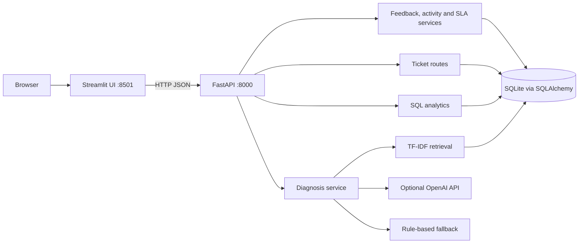

The frontend never queries SQLite directly. `backend/schemas.py` defines the data contract.
`backend/services/diagnosis.py` owns the AI boundary and fallback rules; retrieval is separate
in `backend/services/knowledge.py`.

| Table | Purpose |
| --- | --- |
| `tickets` | UUID, title, description, category, priority, status, UTC timestamps, diagnosis JSON |
| `knowledge_base_articles` | Stable article ID, title, category, symptoms, ordered solution steps |
| `diagnosis_runs` | Server-generated preview UUID, original input, validated result, creation time |
| `ticket_events` | Ordered event ID, ticket FK, type, previous/new value, UTC timestamp, note |
| `troubleshooting_feedback` | Diagnosis FK, outcome, details, optional ticket/follow-up diagnosis FKs |
| `ticket_slas` | One row per ticket, deadline, stop time, legacy estimation flag |

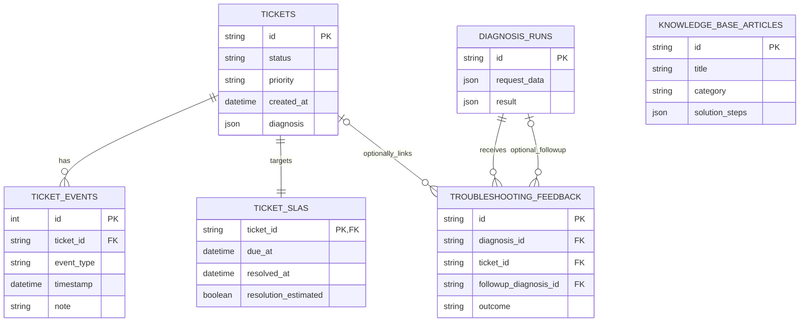

Knowledge retrieval is computed from article text; there is no invented foreign-key relationship
between a ticket's saved JSON citations and mutable article records.

A saved preview is matched to the normalized issue before ticket creation. The browser sends
only its ID, not a trusted diagnostic result. Saving a preview does not call OpenAI again.
Tickets retain their own diagnosis snapshot even if an article later changes.
Database constraints enforce status, priority and category values.

```text
backend/
  main.py              # Application factory, lifespan initialization and error handling
  config.py            # Environment settings; repository-relative paths
  database.py          # Engine, sessions and SQLite setup
  models.py            # SQLAlchemy tables
  schemas.py           # Request/response validation
  routes/api.py        # REST endpoints
  services/
    diagnosis.py       # Prompt, OpenAI adapter, validation and fallback
    knowledge.py       # Idempotent seeding and TF-IDF search
    activity.py        # Append-only application events and honest legacy import markers
    duplicates.py      # Conservative similarity candidates
    sla.py             # UTC calendar-hour deadlines and SQL aggregates
    migrations.py      # Additive, repeatable V1-to-V2 upgrade
frontend/app.py        # Four Streamlit pages using HTTP APIs
knowledge_base/seed_data.json
scripts/seed_database.py
scripts/upgrade_database.py
evaluation/            # 24 labeled cases, offline runner and measured rule results
tests/                 # Isolated temporary databases; no paid API calls
docs/                  # Actual screenshots and validation notes
.github/workflows/tests.yml
```

## Screenshots

V2 captures below show the running application after the non-destructive upgrade:

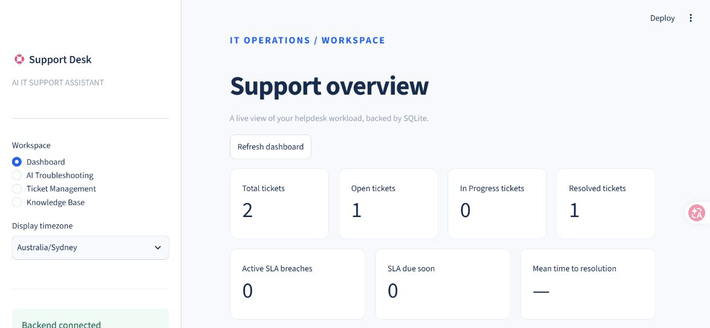
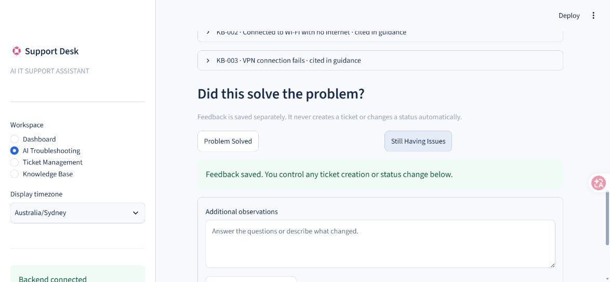
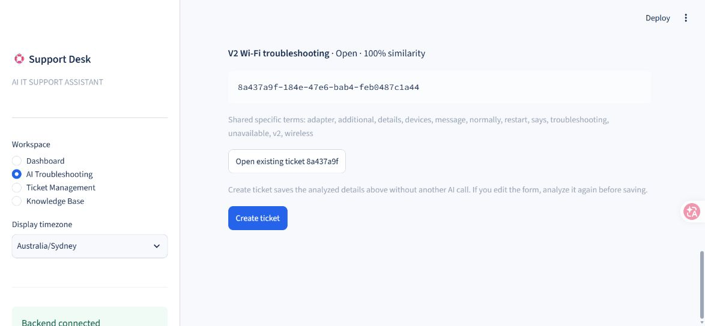
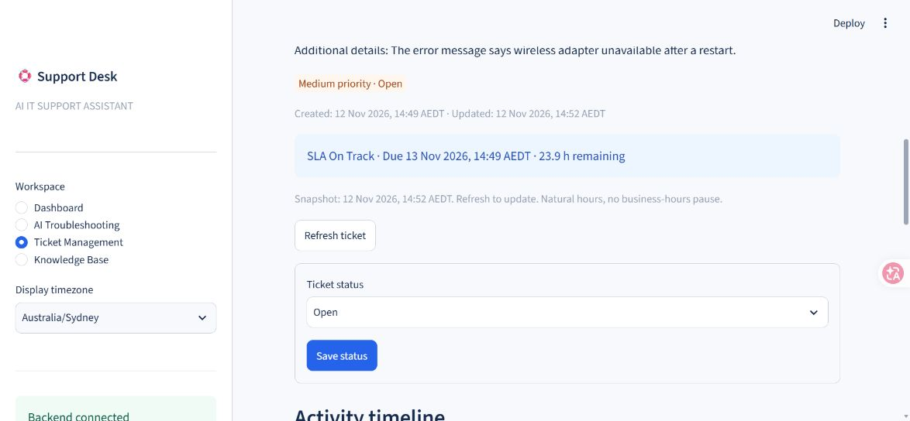
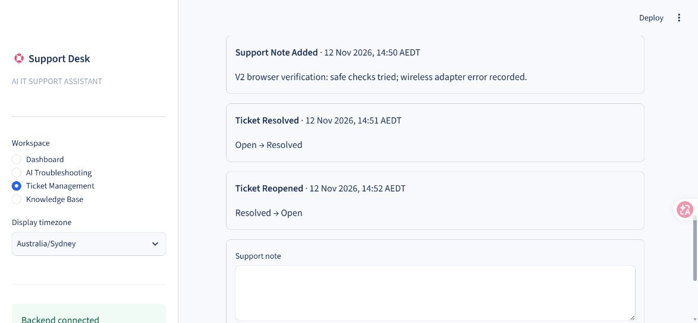

Original V1 captures are retained below as historical validation evidence.

These are actual browser captures of the locally running application in demo mode.
The single Wi-Fi ticket was created during verification; a fresh checkout starts with zero tickets.
No screenshot depicts a paid AI response. The screenshots reflect the captured point in the workflow.

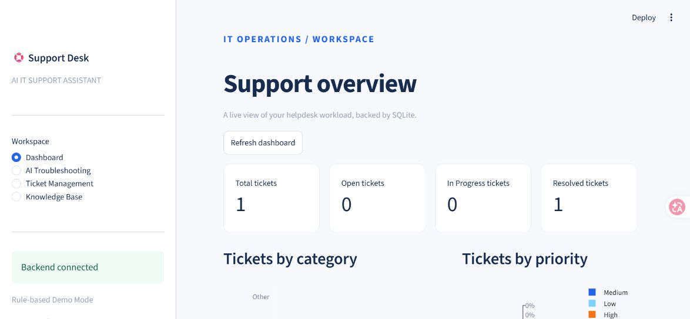
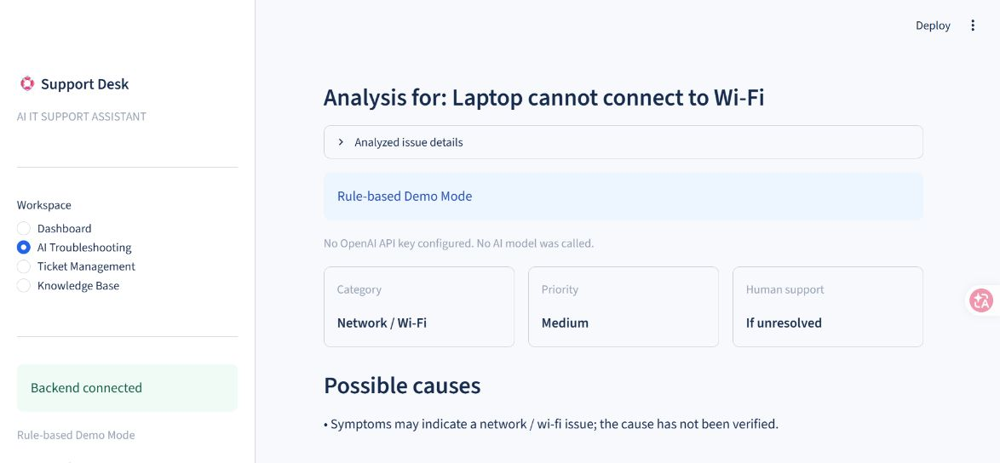
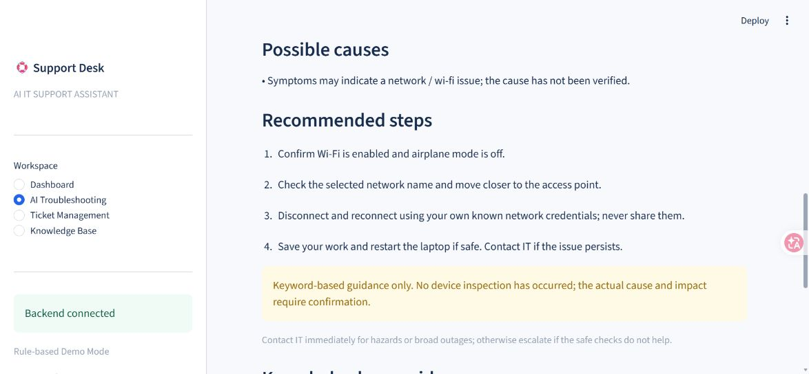
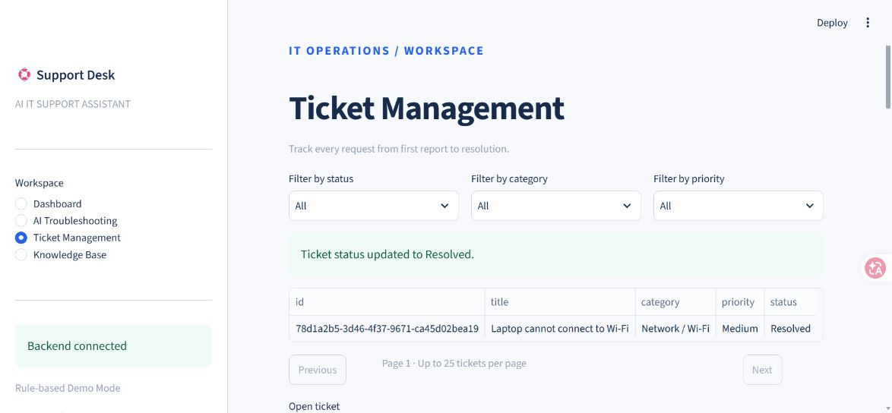
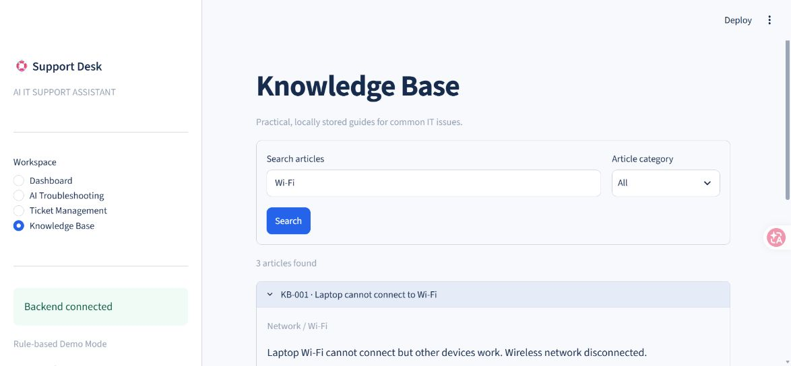

## Installation

Install Python 3.11 or newer and Git. Clone the repository first:

```bash
git clone https://github.com/chenyue-wang-usyd/ai-it-support-assistant.git
cd ai-it-support-assistant
```

Then run the commands below from the repository root:

**Windows PowerShell** (activation is optional):

```powershell
python -m venv .venv
.\.venv\Scripts\python.exe -m pip install -r requirements.txt
Copy-Item .env.example .env
```

**macOS / Linux:**

```bash
python3 -m venv .venv
.venv/bin/python -m pip install -r requirements.txt
cp .env.example .env
```

Leave `OPENAI_API_KEY` empty for free local demo mode. `.env` is ignored by Git.
Do not place secrets in source code, screenshots, issues, or committed files.

## How to Run

Run both commands from the repository root, in **two separate terminals**.

**Terminal 1 — FastAPI (Windows):**

```powershell
.\.venv\Scripts\python.exe -m uvicorn backend.main:app --host 127.0.0.1 --port 8000
```

**Terminal 2 — Streamlit (Windows):**

```powershell
.\.venv\Scripts\python.exe -m streamlit run frontend/app.py --server.address 127.0.0.1 --server.port 8501
```

On macOS / Linux, replace `.\.venv\Scripts\python.exe` with `.venv/bin/python`:

```bash
.venv/bin/python -m uvicorn backend.main:app --host 127.0.0.1 --port 8000
# In another terminal:
.venv/bin/python -m streamlit run frontend/app.py --server.address 127.0.0.1 --server.port 8501
```

Open **http://127.0.0.1:8501**. API docs: **http://127.0.0.1:8000/docs**.
Database tables and articles initialize automatically on backend startup.
To explicitly seed missing articles (safe to repeat):

```powershell
.\.venv\Scripts\python.exe -m scripts.seed_database
```

Seeding inserts missing article IDs and preserves existing records; editing the seed JSON does
not overwrite an existing article. A future editing/import feature would need an explicit update policy.
The default database is `data/helpdesk.db`; it survives process restarts and is ignored by Git.
Relative SQLite paths are resolved against the repository root, not the current terminal directory.

### Try the complete workflow

1. Open **AI Troubleshooting**, enter a title and the description:
   `My laptop cannot connect to Wi-Fi, but other devices work normally.`
2. Select **Auto-detect** and click **Analyze issue**. Review the mode label, steps and KB IDs.
3. Click **Create ticket**. Copy the generated ID or find it in **Ticket Management**.
4. Open **Dashboard** to see database-backed counts (use **Refresh dashboard** after changes).
5. In **Ticket Management**, choose the ticket, select **Resolved**, and click **Save status**.
6. Stop both processes with Ctrl+C and start them again. The same ticket and status remain.
7. Search **Knowledge Base** for `Wi-Fi`, `password`, or `phishing`.

### V2 feedback, duplicate and SLA workflow

After analysis, answer the intake questions using **Still Having Issues** and
**Analyze additional details**. Demo mode re-runs deterministic rules; it does not simulate an
LLM conversation. **Problem Solved** saves feedback only. It never changes a ticket status.
If human support is recommended, the page displays an explicit warning.

Duplicate candidates show UUIDs, titles, statuses, cosine scores and shared specific terms.
**Open existing ticket** navigates to that ticket; it does not link, merge or close it.
You can still click **Create ticket**. The same preflight check runs on backend creation,
with the count in the `X-Possible-Duplicate-Count` response header.
The threshold is configured by `DUPLICATE_SIMILARITY_THRESHOLD` (default 0.78, allowed 0.5–1.0).
At least two non-generic shared words are also required. This conservative heuristic may miss
paraphrases or short reports; it never proves two incidents are identical.

After creating a ticket, follow-up analysis remains separate until you click
**Update linked ticket diagnosis**. This preserves its original report, category, priority,
SLA budget and status. After solved feedback, **Mark linked ticket Resolved** is a separate,
explicit action. Ticket Management also supports notes and reopening via a status change.
Repeatedly saving the same status is a no-op and creates no duplicate event.

### V2 database upgrade

Stop the backend before upgrading, and from the repository root run:

```powershell
.\.venv\Scripts\python.exe -m scripts.upgrade_database
```

This creates a consistent SQLite online backup under `data/backups/`, then creates the three
new V2 tables. No existing table column or ticket row is dropped or rewritten. Startup also
applies the same idempotent additive upgrade, so fresh checkouts work without a separate step.
Existing tickets receive one **Legacy Ticket Imported** event: unavailable historical activity
is not fabricated. Repeated upgrades do not duplicate import events or SLA rows.

For legacy Resolved tickets, V1's last-updated timestamp is an **estimated** stop time.
The UI labels it, and it is excluded from measured average resolution time. Existing ticket
UUIDs, descriptions, statuses, timestamps and diagnostic JSON are preserved by the upgrade.
Backups are local database files and are ignored by Git. This is a V2 additive migration,
not a general-purpose schema migration framework; stop the service before restoring a backup.

### SLA policy (demonstration rules)

| Priority | Continuous calendar-hour target from creation |
| --- | --- |
| High / P1 | 4 hours |
| Medium / P2 | 24 hours |
| Low / P3 | 72 hours |

Targets include nights and weekends. Open and In Progress keep counting. Resolved saves a
stop timestamp; notes and repeated Resolved updates do not restart or move that timestamp.
Reopening clears the stop time and retains the **original deadline**; it does not award a new
budget. Mean resolution time measures creation to the latest resolution, including any earlier
closed intervals. Open/reopened and estimated legacy resolutions are excluded from that mean.

Exactly at the deadline, a ticket is on time (remaining = 0); it is breached only after the
deadline. Due Soon means an active ticket has between 0 and `SLA_WARNING_HOURS` hours remaining
(default 2). Dashboard **Active SLA breaches** excludes resolved tickets; the API separately
reports resolved breaches, including labeled legacy estimates. Average is `null` / “—” without
measured resolutions. These targets are demo policy, not a claim about enterprise standards.
All timestamps are stored and returned in UTC. The sidebar selects display timezone. Remaining
time is a request-time snapshot; use refresh to update it, rather than treating it as a live timer.

If the frontend cannot connect, confirm FastAPI is running and `BACKEND_URL` matches its port.
If a port is occupied, use another port and update `.env` as needed. Restart after changing settings.

## AI Integration

Configure these variables through the process environment or the ignored local `.env` file:

```dotenv
OPENAI_API_KEY=your-local-key
OPENAI_MODEL=gpt-4o-mini
OPENAI_TIMEOUT_SECONDS=25
```

The default model is configurable; access and availability depend on your OpenAI account.
Adding a key enables paid requests when **Analyze issue**, `POST /diagnose`, or direct
`POST /tickets` without a preview ID is used. This project does not bundle API credits.
No paid request was made during development verification.

The service first retrieves up to three local articles using TF-IDF over titles, categories,
symptoms and solution steps. It applies cosine similarity with a minimum relevance threshold.
The prompt separates system instructions from JSON issue/article data, prohibits destructive
advice, states the lack of device access, and asks for uncertainty and escalation guidance.

The SDK's `responses.parse(..., text_format=Analysis)` maps the response to a Pydantic model.
The server additionally rejects citations outside the retrieved IDs, mismatched selected
categories and a limited set of unsafe advice patterns. Unknown or malformed results, refusal,
timeouts and API failures return labeled rule-based guidance instead. SDK automatic retries are
disabled, and calls use a configurable timeout. Results are requested with `store=False`.

The structured-output approach follows the
[official OpenAI documentation](https://developers.openai.com/api/docs/guides/structured-outputs).
Model output remains advisory: schema validation and regex checks cannot prove advice is correct
or safe. No commands or tools are executed. The system never claims to have inspected or fixed a device.

Without a key, keyword rules classify issues, estimate priority and reuse relevant KB steps.
Hazards and broad outages receive High priority; explicit minor-impact descriptions can receive
Low; other reports default to Medium. This is a heuristic, not a service-level agreement engine.

## API Documentation

Interactive Swagger UI: `/docs`. Machine-readable contract: `/openapi.json`.

| Method | Endpoint | Behavior |
| --- | --- | --- |
| GET | `/health` | Database check and key-configuration boolean (not an AI connectivity test) |
| POST | `/diagnose` | Retrieve articles and save a validated diagnosis preview; returns its UUID |
| POST | `/tickets` | Create a ticket; reuse a matching `diagnosis_id` or generate analysis |
| GET | `/tickets` | Filter by `status`, `category`, `priority`; `limit` 1–500, `offset` ≥ 0 |
| GET | `/tickets/{ticket_id}` | Read a UUID ticket and stored diagnosis |
| PATCH | `/tickets/{ticket_id}` | Change `status` only |
| GET | `/knowledge-base` | Browse or search with `q` and optional `category` |
| GET | `/stats` | Total and SQL grouped status/category/priority counts |
| POST | `/diagnose/{id}/feedback` | Save solved/still-having-issues feedback; never change status |
| GET | `/diagnose/{id}/feedback` | Read feedback history |
| POST | `/diagnose/{id}/follow-up` | Append details, save a new analysis; never modify tickets |
| POST | `/tickets/duplicates` | Read-only preflight using the same body as `/diagnose` |
| GET | `/tickets/{id}/events` | Persisted timeline ordered by UTC timestamp, then numeric event ID |
| POST | `/tickets/{id}/notes` | Append a support note event |
| POST | `/tickets/{id}/diagnosis` | User-confirmed application of a saved diagnosis |
| GET | `/tickets/{id}/sla` | Deadline, stop time, remaining seconds and state |
| GET | `/sla/tickets` | SLA queue; `state`, `limit`, `offset` |

V1 endpoints and payloads remain supported; `/stats` has additive SLA fields and diagnoses
have additive `clarifying_questions`. Feedback body: `{"outcome":"solved","ticket_id":null}`.
Follow-up body: `{"details":"The error now says adapter unavailable.","ticket_id":null}`.
Note body: `{"note":"User confirmed the issue recurred."}`.
Apply-diagnosis body: `{"diagnosis_id":"a-valid-preview-uuid"}`; the title must match or return 409.
Follow-up details are 10–2,000 characters, notes 1–1,000, and the combined issue remains capped
at 6,000. Read the OpenAPI schema for the complete contracts.

Example ticket creation (JSON body for Swagger UI or an HTTP client):

```json
{
  "title": "Laptop Wi-Fi issue",
  "description": "My laptop cannot connect to Wi-Fi, but other devices work normally.",
  "category": null
}
```

`category: null` enables classification. To reuse a preview, add its `diagnosis_id` to the
same original input. PATCH body: `{"status": "Resolved"}`.

Statuses: `Open`, `In Progress`, `Resolved`. Priorities: `Low`, `Medium`, `High`.
Categories: `Network / Wi-Fi`, `Software`, `Hardware`, `Account / Login`, `Email`, `Other`.

Creation returns **201**; reads/updates/diagnosis return **200**; missing records return **404**;
a changed issue with an old preview returns **409**; invalid input returns **422**;
database failures return a sanitized **503**. Extra request fields are rejected.
All API timestamps are serialized in UTC.

## Testing

```powershell
.\.venv\Scripts\python.exe -m pytest -q --cov=backend --cov-report=term-missing
.\.venv\Scripts\python.exe -m ruff check .
.\.venv\Scripts\python.exe -m ruff format --check .
.\.venv\Scripts\python.exe -m pip check
```

Tests create temporary SQLite databases, start the actual FastAPI lifespan, and replace the
external AI boundary. An autouse guard fails any unmocked OpenAI client construction.
Streamlit AppTest exercises navigation, analysis, ticket saving, status changes, dashboard
updates, search, validation and a disconnected backend against the isolated API.

Coverage includes ticket creation/query/update, validation, missing IDs, filtering/pagination,
database persistence across app instances, idempotent KB initialization, KB search, structured
AI output, citation validation, unsafe advice rejection, missing keys, refusal, timeout,
connection failure and rate limits. V2 adds legacy-upgrade preservation, transaction rollback,
feedback, event ordering, duplicate filtering, clock-controlled SLA boundaries and evaluation tests.
The local V2 suite passed **71 tests**, with **99% backend line coverage (616/619 statements)**.
No tests or new code were excluded to maintain the V1 coverage figure.
See [V2 validation](docs/V2_VALIDATION.md) and the retained [V1 validation](docs/VALIDATION.md).
GitHub Actions runs the checks on Ubuntu with Python 3.11 and 3.12. The badge above links to
the actual workflow status; local validation records retain their original verification dates.
Both remote environments passed for the first published code commit; the linked V2 validation
record includes the actual GitHub Actions run.

## Limitations

- Local single-user portfolio demonstration. No authentication, tenant isolation, authorization,
  encryption at rest, tamper-resistant auditing, rate limiting or production deployment hardening.
- Bind to loopback. Do not expose this application to the public internet as an enterprise service.
- English seed articles and English keyword rules; TF-IDF does not understand semantic equivalents
  or reliably support multilingual issues. Retrieval can include weak matches.
- Model quality and real account connectivity have not been verified with a paid request.
- Safety checks are partial. Read advice critically and involve IT for uncertain or risky work.
- SQLite is appropriate for the demo workload; concurrent writes can contend. The additive V2 upgrade
  is provided, but there is no general migration framework or backup/retention UI.
- SLA queue filtering and duplicate retrieval scan local tickets, so they are intended for demo-scale
  data. There is no background SLA worker or push notification system.
- Diagnostic inputs and results are stored locally. With a key, issue text and retrieved articles
  are transmitted to OpenAI. Do not enter credentials or confidential customer information.
- Preview records have no expiry/cleanup. The UI prevents a repeated save during the same preview,
  but direct API clients can create multiple tickets from it; there is no general idempotency key.
- Screenshots show real local validation data, which is deliberately excluded from the repository database.

## Future Improvements

- Authentication, role-based access, ticket assignment and an audit trail.
- A versioned migration framework, backup UI and configurable diagnostic retention.
- Better retrieval evaluation, language support and relevance tuning.
- A held-out human-reviewed safety/accuracy benchmark and budgeted live model evaluations.
- Attachments, business-hours SLA calendars, assignments and notification delivery.

## Engineering Decisions

- **FastAPI:** typed REST contracts and input validation keep business operations independently testable
  and reusable by a future frontend.
- **SQLite:** a single persistent file makes a local portfolio demo easy to run without infrastructure.
  PostgreSQL and proper migrations would be evaluated for a concurrent deployed service.
- **TF-IDF:** understandable, deterministic retrieval at zero embedding cost for 18 articles and a
  small ticket set. Its lexical limitations are measured and documented rather than hidden.
- **Rule-based Demo Mode:** recruiters can exercise the entire helpdesk without a key, account or bill.
  Rule outputs and failed AI requests are never presented as successful model analysis.
- **Beyond a chatbot:** explicit user actions drive durable tickets, structured diagnostics, feedback,
  transactionally recorded activity and SLA calculations. The model has no database-operation tools.

## AI Evaluation

Run the reproducible **offline rule-mode** evaluation without a key:

```powershell
.\.venv\Scripts\python.exe -m evaluation.run --mode rule
```

| Metric | Measured result |
| --- | --- |
| Classification accuracy | 23/24 = 95.83% |
| Knowledge retrieval Hit@3 | 21/21 = 100% of cases with a target article |
| Escalation decision accuracy | 22/24 = 91.67% |
| No-article abstention | 2/3 cases with no target article |

The 24 synthetic, manually labeled cases include Wi-Fi, hardware, software, account, email,
VPN, ambiguous and unknown issues. This small in-repository dataset is based on the seeded KB;
it is not a held-out benchmark, evidence of production quality or OpenAI model accuracy.
The runner seeds a temporary database and never modifies your tickets. It records per-case
predictions and dataset/KB hashes in [results-rule.json](evaluation/results-rule.json).
See [evaluation methodology and failures](evaluation/README.md).

**Mock AI tests** verify integration behavior, not model quality. **Real OpenAI evaluation has
not been run.** Optional live mode requires both a key and an explicit `--allow-paid` flag:

```powershell
# Optional only; may incur charges for 24 requests. Not required for the demo or CI.
.\.venv\Scripts\python.exe -m evaluation.run --mode live --allow-paid
```

Live results use a separate file. Failed/refused/fallback responses count as incorrect
classification/escalation decisions, with service successes reported separately; rule fallback
is never counted as a successful model prediction. Retrieval Hit@3 measures the shared local
retriever in either mode. CI runs offline only; no external paid evaluation was performed here.

## Contributing and Development

Repository: [chenyue-wang-usyd/ai-it-support-assistant](https://github.com/chenyue-wang-usyd/ai-it-support-assistant).
Keep changes small and run the tests before opening a pull request. For example:

```powershell
git switch -c improve-ticket-workflow
# Make your changes, then run the checks in the Testing section.
git add .
git diff --cached --stat
git diff --cached
git commit -m "Describe the concrete behavior change"
git push -u origin improve-ticket-workflow
```

Use Issues and small pull requests for future improvements; a PR template and CI checks are included.
Never commit `.env`, credentials, local databases, backups or the virtual environment.
Read [LEARNING_GUIDE.md](LEARNING_GUIDE.md) for a Chinese walkthrough and interview practice.
